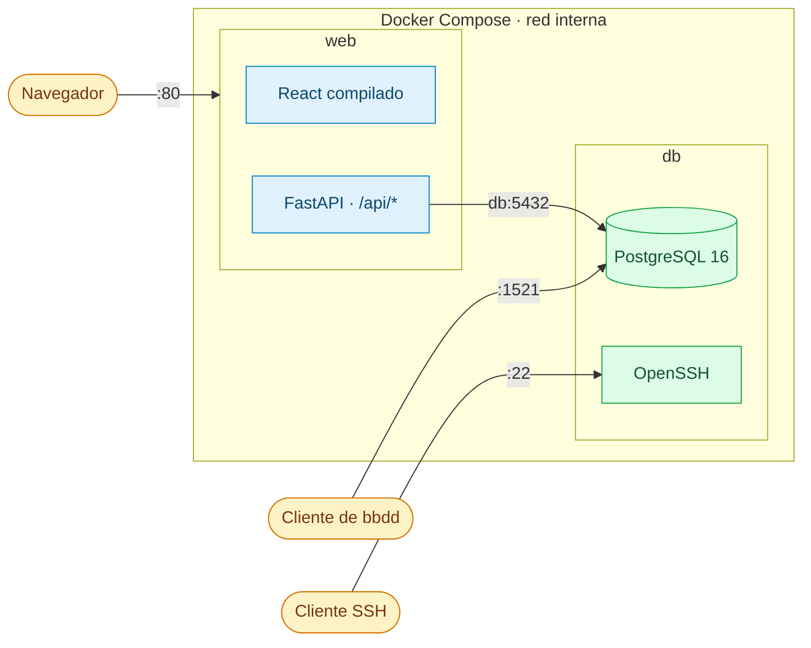
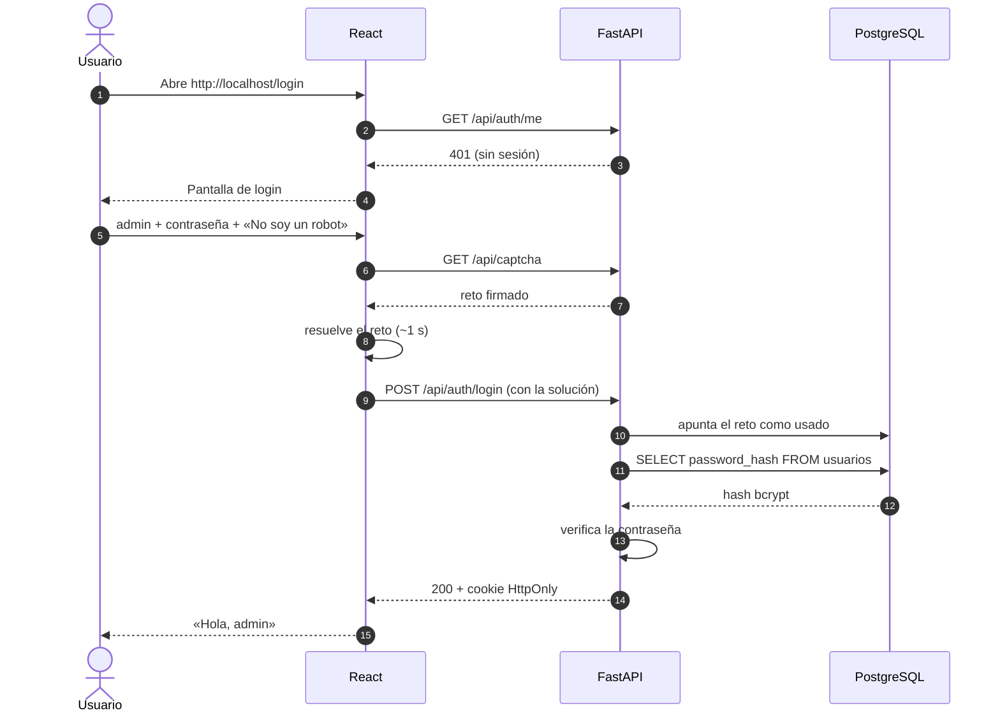

<div align="center">

# practicas-unileon-2026

**Proyecto I+D para diseñar y desarrollar un gestor documental**


[Arquitectura](#arquitectura) · [Puesta en marcha](#puesta-en-marcha) · [Uso](#uso) · [API](#api) · [Cómo funciona](#cómo-funciona-por-dentro) · [Desarrollo](#desarrollo-y-tests) · [Problemas](#problemas-frecuentes)

</div>

---

> [!NOTE]
> **Primera entrega:** el entorno en dos contenedores Docker con una aplicación web mínima
> (login y home con logout) cuyo usuario vive en la base de datos.
>
> **Issue #4:** logo en el login, recuperación de contraseña por correo y captcha anti-bot.
>
> **Issue #5:** menú de la aplicación y gestión de roles, solo para el administrador.
>
> **Issue #6:** gestión de usuarios (alta con contraseña por correo, edición, borrado en lote y
> sus roles), solo para el administrador.

## Arquitectura



| Contenedor | Contenido | Puertos publicados |
|---|---|---|
| `web` | FastAPI sirve la API (`/api/*`) y el frontend React compilado. | `80` |
| `db` | PostgreSQL 16 + OpenSSH. Al arrancar crea las tablas si no existen. | `1521` → 5432 (Postgres), `22` (SSH) |

> [!IMPORTANT]
> Ningún otro puerto queda expuesto. La web llega a la bbdd por la **red interna** de Docker
> (`db:5432`), que no es accesible desde fuera.

## Puesta en marcha

**Requisitos:** [Docker Desktop](https://www.docker.com/products/docker-desktop/) (o Docker Engine + Compose v2).

```bash
git clone https://github.com/rubenrodriguezcds/practicas-unileon-2026.git
cd practicas-unileon-2026
cp .env.example .env          # y cambia los valores (ver abajo)
docker compose up -d --build
docker compose ps             # db (healthy) y web (Up)
```

> [!TIP]
> Abre **http://localhost/login** (puerto 80, el de la web por defecto) e inicia sesión con el
> usuario `admin` y la contraseña que pusiste en `APP_ADMIN_PASSWORD`.

### Variables de entorno (`.env`)

| Variable | Para qué |
|---|---|
| `POSTGRES_DB`, `POSTGRES_USER`, `POSTGRES_PASSWORD` | Base de datos y credenciales de Postgres (las usan `db` y `web`) |
| `SSH_USER`, `SSH_PASSWORD` | Usuario para entrar por SSH al contenedor `db` |
| `APP_ADMIN_PASSWORD` | Contraseña del usuario `admin` de la aplicación web. Se crea al inicializar la bbdd: para cambiarla después hay que recrearla (`docker compose down -v`) |
| `APP_SECRET` | Firma de la cookie de sesión. **Mínimo 32 caracteres** o la web no arranca |
| `APP_ADMIN_EMAIL` | Email del `admin`, a donde llega su contraseña nueva si la resetea. La API se lo pone al arrancar si aún no tiene |
| `ALTCHA_HMAC_KEY` | Clave con la que la API firma los retos del captcha. **Mínimo 32 caracteres** o la web no arranca |
| `ALTCHA_ENABLED` | `false` desactiva el captcha (solo tests o desarrollo; la API lo avisa en el log). Por defecto `true` |
| `RESET_MAX_POR_HORA` | Reseteos de contraseña permitidos por hora, por usuario y por IP. Por defecto `5` |
| `SMTP_HOST`, `SMTP_PORT`, `SMTP_USER`, `SMTP_PASSWORD`, `SMTP_FROM` | Servidor de correo para el reseteo. **Vacío = modo log** (ver aviso abajo) |
| `SMTP_TLS` | `starttls` (puerto 587, Brevo y Gmail; por defecto), `ssl` (465) o `none` |

Para generar un `APP_SECRET` o un `ALTCHA_HMAC_KEY`:

```bash
python -c "import secrets;print(secrets.token_hex(32))"
```

> [!CAUTION]
> El `.env` contiene secretos y **no se sube nunca** al repositorio (está en `.gitignore`).

> [!WARNING]
> **Modo log del correo, solo para desarrollo.** Con `SMTP_HOST` vacío los correos no se
> envían: se escriben en `docker compose logs web` **con la contraseña nueva en claro**. En
> cualquier entorno compartido hay que configurar un servidor SMTP. El proyecto usa
> [Brevo](https://www.brevo.com) (gratis, sin dominio propio): `SMTP_HOST=smtp-relay.brevo.com`,
> `SMTP_PORT=587`, `SMTP_TLS=starttls`, el login y la clave SMTP de Brevo en `SMTP_USER` y
> `SMTP_PASSWORD`, y en `SMTP_FROM` el remitente verificado en Brevo. Gmail con contraseña de
> aplicación también funciona; Outlook.com personal no (Microsoft exige OAuth2).

> [!NOTE]
> El captcha ([ALTCHA](https://altcha.org)) es open source y lo sirve la propia API: **no
> necesita ninguna cuenta externa** (ni Google ni Cloudflare), solo la clave `ALTCHA_HMAC_KEY`.

## Uso

| Qué | Cómo |
|---|---|
| Aplicación web | http://localhost/login |
| Recuperar contraseña | http://localhost/reset-password (o «¿Olvidaste tu contraseña?» en el login) |
| Gestión de usuarios (solo administrador) | http://localhost/usuarios (o «Usuarios» en el menú) |
| Gestión de roles (solo administrador) | http://localhost/roles (o «Roles» en el menú) |
| Estado de la API | http://localhost/api/health |
| Documentación de la API | http://localhost/api/docs |
| Consultar la bbdd | `docker compose exec db psql -U gestor -d gestor` (ya incluido), o cualquier cliente de PostgreSQL (DBeaver, pgAdmin…) con host `localhost` y puerto `1521` |
| SSH al contenedor de bbdd | `ssh -p 22 <SSH_USER>@localhost` |
| Ver logs | `docker compose logs -f web` / `docker compose logs -f db` |
| Parar (conserva los datos) | `docker compose down` |
| Parar y borrar la bbdd | `docker compose down -v` (al volver a arrancar se recrean las tablas) |

## API

| Método | Ruta | Respuesta |
|---|---|---|
|  | `/api/auth/login` `{"username","password","altcha"}` | 200 `{"username","es_admin"}` + cookie de sesión · 400 captcha no válido · 401 si las credenciales no son válidas |
|  | `/api/auth/reset` `{"username","altcha"}` | 202 siempre con el mismo mensaje · 400 captcha no válido · 429 demasiados intentos |
|  | `/api/captcha` | 200 reto del captcha (caduca en 5 minutos) |
|  | `/api/auth/logout` | 204 |
|  | `/api/auth/me` | 200 `{"username","es_admin"}` · 401 sin sesión |
|  | `/api/health` | 200 `{"status":"ok"}` |

**Roles** (solo administrador: 401 sin sesión, **403** si el usuario no es administrador):

| Método | Ruta | Respuesta |
|---|---|---|
|  | `/api/roles` | 200 lista de roles por nombre, con `num_usuarios` |
|  | `/api/roles` `{"nombre","descripcion"}` | 201 rol creado · 409 nombre repetido |
|  | `/api/roles/{id}` `{"nombre","descripcion"}` | 200 rol editado · 404 · 409 nombre repetido |
|  | `/api/roles/{id}` | 204 · 404 · 409 si algún usuario tiene el rol |
|  | `/api/roles/{id}/usuarios` | 200 usuarios que tienen el rol · 404 |

**Usuarios** (solo administrador: 401 sin sesión, **403** si el usuario no es administrador):

| Método | Ruta | Respuesta |
|---|---|---|
|  | `/api/usuarios` | 200 lista de usuarios por nombre, con `num_roles` |
|  | `/api/usuarios/{id}` | 200 usuario con sus `roles` · 404 |
|  | `/api/usuarios` `{"username","email","es_admin"}` | 201 usuario (la contraseña le llega por correo) · 409 nombre repetido · 502 no salió el correo (no se crea) |
|  | `/api/usuarios/{id}` `{"username","email","es_admin"}` | 200 usuario · 404 · 409 nombre repetido o quitarse el propio permiso |
|  | `/api/usuarios/{id}` | 204 · 404 · 409 si es uno mismo |
|  | `/api/usuarios/borrar` `{"ids"}` | 200 `{"borrados"}` · 409 si incluye a uno mismo (no borra ninguno) |
|  | `/api/usuarios/{id}/roles/{rol_id}` | 204 asocia el rol · 404 usuario o rol inexistente |
|  | `/api/usuarios/{id}/roles/{rol_id}` | 204 quita el rol |

> [!WARNING]
> Si la base de datos no está disponible, la API responde **503** «Base de datos no disponible».

<details>
<summary><b>Flujo de inicio de sesión, paso a paso</b></summary>



</details>

<details>
<summary><b>Recuperar la contraseña: cómo funciona y por qué así</b></summary>

1. El usuario escribe su nombre, resuelve el captcha y pulsa «Enviar contraseña nueva».
2. La API genera una contraseña aleatoria, la guarda con hash bcrypt como **pendiente** (vale
   1 hora) y la envía al email del usuario. Solo si el correo sale, se confirma en la bbdd.
3. La contraseña de siempre **sigue funcionando**. Al entrar con la nueva, la nueva pasa a ser
   la contraseña y la vieja deja de valer. Si entra con la vieja, la pendiente se descarta.

Por qué así:

- **Nadie puede dejar sin acceso a otro.** Si la contraseña cambiara al pedir el reseteo,
  bastaría saber un nombre de usuario para bloquearlo. Así, un reseteo que no pidió el dueño
  solo le genera un correo que puede ignorar.
- **No revela qué usuarios existen.** La respuesta es siempre la misma (exista o no el usuario,
  tenga o no email, falle o no el correo). Los fallos de correo quedan en el log del servidor.
- **Límite de intentos** por usuario y por IP (`RESET_MAX_POR_HORA`). Al superarlo responde 429.
- **Captcha** en el login y en el reseteo. Cada reto caduca a los 5 minutos y vale una sola vez.

</details>

<details>
<summary><b>Gestión de roles: cómo funciona y por qué así</b></summary>

- **Quién es administrador** lo dice la columna `usuarios.es_admin` (por defecto `false`; el
  `admin` del seed la tiene a `true`).
- **Solo el administrador** ve la entrada «Roles» del menú. Esconderla es solo comodidad: quien
  protege es la API, que comprueba `es_admin` **en la bbdd en cada petición** y responde 403 si no
  lo es. Así, quitar el permiso a alguien surte efecto en su siguiente petición.
- **Un usuario puede tener varios roles** (tabla `usuario_roles`).
- **El nombre del rol es único**: dos roles con el mismo nombre serían indistinguibles.
- **Un rol que tienen usuarios no se puede borrar** (409, indicando cuántos): borrarlo les quitaría
  el rol sin avisar. La bbdd también lo impide (`ON DELETE RESTRICT`).
- **Los roles se asignan** desde el detalle de cada usuario, en http://localhost/usuarios.

</details>

<details>
<summary><b>Gestión de usuarios: cómo funciona y por qué así</b></summary>

- **Contraseña del usuario nuevo**: la genera la API al azar y se la envía al email del usuario
  (con el mismo correo que el reseteo). El administrador nunca la conoce; por eso el email es
  obligatorio al crear. **Si el correo no sale, el usuario no se crea** (502) y el administrador lo
  ve al momento.
- **El administrador no puede borrarse a sí mismo ni quitarse su propio permiso.** Como quien hace
  los cambios siempre es un administrador, así siempre queda al menos uno.
- **Borrado en lote todo o nada respecto a uno mismo**: si la selección te incluye, no se borra
  ninguno. Borrar un usuario borra también sus roles asignados.
- **La sesión guarda el id del usuario**, no su nombre: así renombrar a alguien (o a uno mismo) no
  le cierra la sesión.
- **Nombre de usuario**: 1–50 caracteres, solo letras, números y `. _ -` (se escribe al iniciar
  sesión).

</details>

## Cómo funciona por dentro

- **Creación del modelo de datos**: los scripts de `db/init/` se ejecutan automáticamente
  la primera vez que arranca el contenedor (con el volumen vacío). Además son idempotentes
  (`CREATE TABLE IF NOT EXISTS`, `ON CONFLICT DO NOTHING`), así que relanzarlos no rompe nada.
- **Migraciones**: los scripts de `db/init/` solo crean la bbdd desde cero. Para cambiar el
  esquema de una bbdd que ya tiene datos (añadir una columna, una tabla…) se añade un fichero
  `api/migrations/NNN_nombre.sql`. La API aplica al arrancar los que falten, en orden, y los
  apunta en la tabla `migraciones_aplicadas`. Así nadie tiene que borrar la bbdd para actualizar.
- **Datos persistentes** en el volumen `pgdata`: sobreviven a `docker compose down`.
- **Orden de arranque**: `web` espera a que `db` pase su *healthcheck* (`pg_isready`).
- **Contraseñas** guardadas con hash bcrypt; nunca en claro.
- **Sesión** en una cookie firmada `HttpOnly` (el JavaScript de la página no puede leerla).
- **Imagen web** en dos etapas: Node compila el frontend y la imagen final solo lleva
  Python, la API y los estáticos. Se ejecuta sin usuario root.

<details>
<summary><b>Estructura del repositorio</b></summary>

```
docker-compose.yml        Orquesta db + web
.env.example              Plantilla de variables
db/                       Contenedor de base de datos
  Dockerfile              postgres:16 + openssh-server
  entrypoint.sh           Arranca sshd y luego el arranque oficial de Postgres
  init/01_schema.sql      Tablas
  init/02_seed.sh         Usuario admin de la web (contraseña del .env)
api/                      Backend FastAPI
  app/config.py           Configuración desde variables de entorno
  app/db.py               Conexión a Postgres y consultas
  app/migrations.py       Aplica las migraciones pendientes al arrancar
  app/security.py         Hash y verificación de contraseñas
  app/deps.py             Permisos: usuario de la sesión y exigir administrador
  app/captcha.py          Retos y verificación del captcha ALTCHA
  app/mailer.py           Envío de correo (SMTP o log)
  app/routers/auth.py     Login, logout, sesión y reseteo de contraseña
  app/routers/captcha.py  Entrega retos del captcha
  app/routers/roles.py    Gestión de roles (solo administrador)
  app/routers/usuarios.py Gestión de usuarios y de sus roles (solo administrador)
  app/spa.py              Sirve el frontend compilado
  app/main.py             Monta la aplicación
  migrations/             Cambios de esquema (NNN_nombre.sql)
  tests/
frontend/                 Frontend React + Vite + TypeScript
  src/api/client.ts       Único punto de llamada a la API
  src/pages/              Login, ResetPassword, Home, Roles, Usuarios y UsuarioDetalle
  src/components/         Captcha, Logo y Layout (menú de las pantallas con sesión)
  src/App.tsx             Rutas y control de sesión
docker/web.Dockerfile     Imagen del contenedor web
```

</details>

> [!NOTE]
> El frontend solo llama a rutas relativas `/api/...` y la API no depende del frontend, de
> modo que más adelante se puede separar en **tres contenedores** (frontend con nginx, API y
> bbdd) cambiando solo los Dockerfiles y el compose.

## Desarrollo y tests

<details>
<summary><b>API (FastAPI)</b></summary>

```bash
cd api
python -m venv .venv
.venv/Scripts/activate        # Windows  (Linux/Mac: source .venv/bin/activate)
pip install -r requirements-dev.txt
pytest -q
ruff check .                  # linter
```

Para levantar la API en local: `uvicorn app.main:app --port 8000` dentro de `api/` (con las
variables de `.env` cargadas y una bbdd accesible).

</details>

<details>
<summary><b>Frontend (React + Vite)</b></summary>

```bash
cd frontend
npm ci
npm test
npm run lint
npm run dev                   # http://localhost:5173, redirige /api a localhost:8000
```

</details>

## Problemas frecuentes

<details>
<summary><b>Docker arranca pero el login con <code>admin</code> dice «Usuario o contraseña incorrectos»</b></summary>

El usuario `admin` se crea **solo la primera vez**, cuando la base de datos está vacía. Si la
bbdd ya existía de antes (otra versión del seed u otra `APP_ADMIN_PASSWORD`), conserva la
contraseña antigua. Recréala (borra los datos):

```bash
docker compose down -v
docker compose up -d --build
```

Para comprobar qué hay: `docker compose logs db | grep 02_seed` debe mostrar que se ejecutó
`02_seed.sh`, y comprueba que entras por **http://localhost/login** (no por `:5173`).

</details>

<details>
<summary><b>El puerto 80 o el 22 ya está en uso</b></summary>

Suele ser IIS o el OpenSSH Server de Windows. Compruébalo con `netstat -ano | findstr :80`
(o `:22`) y para ese servicio, o cambia el puerto de la izquierda en `docker-compose.yml`
(p. ej. `"2222:22"`).

</details>

<details>
<summary><b>El login falla en <code>http://localhost:5173</code></b></summary>

Ese es el servidor de desarrollo de Vite (`npm run dev`) y necesita la API arrancada aparte
en el puerto 8000. La aplicación de Docker está en **http://localhost/login**.

</details>

<details>
<summary><b>El contenedor <code>web</code> no arranca (o se para nada más arrancar)</b></summary>

Mira el motivo con `docker compose logs web --tail 30` y `docker compose logs db --tail 30`:

- **`app_secret` … `at least 32 characters`**: el `APP_SECRET` del `.env` es demasiado corto.
  El de `.env.example` (`cambia-esto`) lo es a propósito, para que nadie use un secreto
  conocido. Genera uno con `python -c "import secrets;print(secrets.token_hex(32))"`.
- **`ALTCHA_HMAC_KEY debe tener al menos 32 caracteres`**: falta la clave del captcha en el
  `.env` (pasa al actualizar desde una versión anterior). Genérala igual que `APP_SECRET`.
- **`Falta APP_ADMIN_PASSWORD en el .env`** (en el log de `db`): sin esa variable la bbdd no
  arranca, y `web` espera a que `db` esté sana. Añádela y haz `docker compose down -v` y `up`.
- **`port is already allocated`**: otra cosa usa el puerto 80 (ver «El puerto 80 o el 22 ya está en uso»).

</details>

<details>
<summary><b>Cambié <code>APP_ADMIN_PASSWORD</code> o los scripts de <code>db/init/</code> y no se aplican</b></summary>

Solo se ejecutan con el volumen vacío; usa `docker compose down -v` (borra los datos). Para
cambiar el esquema sin borrar datos, añade una migración en `api/migrations/`.

</details>

<details>
<summary><b>He pedido una contraseña nueva y no me llega el correo</b></summary>

- Sin `SMTP_HOST` en el `.env` no se envía nada: el correo está en `docker compose logs web`.
- Con SMTP configurado, si el envío falla el error aparece en `docker compose logs web` y la
  contraseña no cambia (a propósito, la página muestra el mismo mensaje que si hubiera ido bien).
- El usuario necesita un email en la bbdd: el `admin` lo toma de `APP_ADMIN_EMAIL`.

</details>

<details>
<summary><b>¿Cómo asigno un rol a un usuario, o hago administrador a otro?</b></summary>

Desde http://localhost/usuarios: pulsa el usuario y, en su detalle, marca «Administrador» y
guarda, o añade y quita roles en la tabla «Roles». El rol se crea antes en http://localhost/roles.

</details>

<details>
<summary><b>He creado un usuario y no le llega la contraseña</b></summary>

- Si el correo falla, el usuario **no se crea** y la pantalla lo dice; el motivo está en
  `docker compose logs web --tail 30`. Revisa también la carpeta de spam.
- Sin `SMTP_HOST` en el `.env`, el correo (con la contraseña) se escribe en `docker compose logs web`.
- Si el usuario ya existe y perdió la contraseña, puede pedir otra en «¿Olvidaste tu contraseña?».

</details>

<details>
<summary><b>Tras actualizar me pide iniciar sesión otra vez</b></summary>

Es normal una vez: desde la issue #6 la sesión guarda el id del usuario en vez del nombre, y las
sesiones antiguas dejan de valer.

</details>

<details>
<summary><b>No veo «Usuarios» ni «Roles» en el menú</b></summary>

Solo aparece al administrador (`usuarios.es_admin = true`). Si acabas de cambiarlo en la bbdd,
recarga la página.

</details>

## Equipo

| Persona | Parte |
|---|---|
| Sergio Martínez | Contenedor web (API y frontend) |
| Mario Costello | Contenedor de base de datos, docker-compose, gestión de roles y de usuarios |
| Rubén Rodriguez | Tutor |
