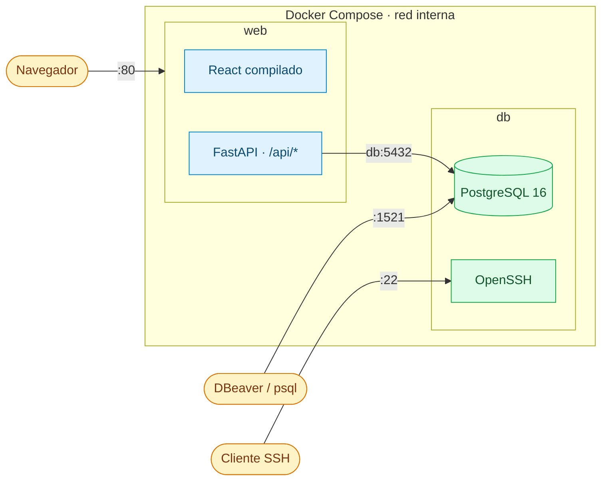
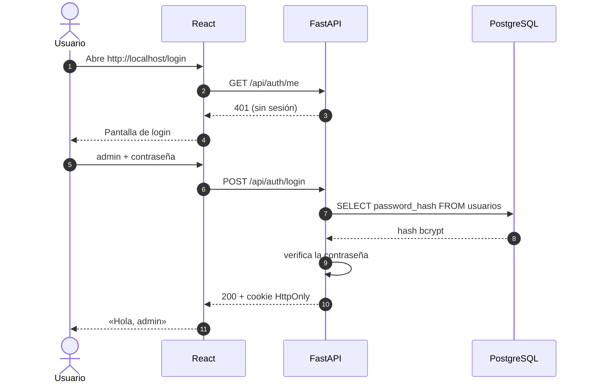

<div align="center">

# practicas-unileon-2026

**Proyecto I+D para diseñar y desarrollar un gestor documental**


[Arquitectura](#arquitectura) · [Puesta en marcha](#puesta-en-marcha) · [Uso](#uso) · [API](#api) · [Cómo funciona](#cómo-funciona-por-dentro) · [Desarrollo](#desarrollo-y-tests) · [Problemas](#problemas-frecuentes)

</div>

---

> [!NOTE]
> **Primera entrega:** el entorno en dos contenedores Docker con una aplicación web mínima
> (login y home con logout) cuyo usuario vive en la base de datos.

## Arquitectura



| Contenedor | Contenido | Puertos publicados |
|---|---|---|
| `web` | FastAPI sirve la API (`/api/*`) y el frontend React compilado. | `80` |
| `db` | PostgreSQL 16 + OpenSSH. Al arrancar crea las tablas si no existen. | `1521` → 5432 (Postgres), `22` (SSH) |

> [!IMPORTANT]
> Ningún otro puerto queda expuesto. La web llega a la bbdd por la **red interna** de Docker
> (`db:5432`), que no es accesible desde fuera.

## Puesta en marcha

**Requisitos:** [Docker Desktop](https://www.docker.com/products/docker-desktop/) (o Docker Engine + Compose v2).

```bash
git clone https://github.com/rubenrodriguezcds/practicas-unileon-2026.git
cd practicas-unileon-2026
cp .env.example .env          # y cambia los valores (ver abajo)
docker compose up -d --build
docker compose ps             # db (healthy) y web (Up)
```

> [!TIP]
> Abre **http://localhost/login** (puerto 80, el de la web por defecto) e inicia sesión con el
> usuario `admin` y la contraseña que pusiste en `APP_ADMIN_PASSWORD`.

### Variables de entorno (`.env`)

| Variable | Para qué |
|---|---|
| `POSTGRES_DB`, `POSTGRES_USER`, `POSTGRES_PASSWORD` | Base de datos y credenciales de Postgres (las usan `db` y `web`) |
| `SSH_USER`, `SSH_PASSWORD` | Usuario para entrar por SSH al contenedor `db` |
| `APP_ADMIN_PASSWORD` | Contraseña del usuario `admin` de la aplicación web. Se crea al inicializar la bbdd: para cambiarla después hay que recrearla (`docker compose down -v`) |
| `APP_SECRET` | Firma de la cookie de sesión. **Mínimo 32 caracteres** o la web no arranca |

Para generar un `APP_SECRET`:

```bash
python -c "import secrets;print(secrets.token_hex(32))"
```

> [!CAUTION]
> El `.env` contiene secretos y **no se sube nunca** al repositorio (está en `.gitignore`).

## Uso

| Qué | Cómo |
|---|---|
| Aplicación web | http://localhost/login |
| Estado de la API | http://localhost/api/health |
| Documentación de la API | http://localhost/api/docs |
| Postgres desde el host | `psql -h localhost -p 1521 -U gestor gestor` (o DBeaver con host `localhost`, puerto `1521`) |
| SSH al contenedor de bbdd | `ssh -p 22 <SSH_USER>@localhost` |
| Ver logs | `docker compose logs -f web` / `docker compose logs -f db` |
| Parar (conserva los datos) | `docker compose down` |
| Parar y borrar la bbdd | `docker compose down -v` (al volver a arrancar se recrean las tablas) |

## API

| Método | Ruta | Respuesta |
|---|---|---|
|  | `/api/auth/login` `{"username","password"}` | 200 `{"username"}` + cookie de sesión · 401 si las credenciales no son válidas |
|  | `/api/auth/logout` | 204 |
|  | `/api/auth/me` | 200 `{"username"}` · 401 sin sesión |
|  | `/api/health` | 200 `{"status":"ok"}` |

> [!WARNING]
> Si la base de datos no está disponible, la API responde **503** «Base de datos no disponible».

### Flujo de inicio de sesión



## Cómo funciona por dentro

- **Creación del modelo de datos**: los scripts de `db/init/` se ejecutan automáticamente
  la primera vez que arranca el contenedor (con el volumen vacío). Además son idempotentes
  (`CREATE TABLE IF NOT EXISTS`, `ON CONFLICT DO NOTHING`), así que relanzarlos no rompe nada.
- **Datos persistentes** en el volumen `pgdata`: sobreviven a `docker compose down`.
- **Orden de arranque**: `web` espera a que `db` pase su *healthcheck* (`pg_isready`).
- **Contraseñas** guardadas con hash bcrypt; nunca en claro.
- **Sesión** en una cookie firmada `HttpOnly` (el JavaScript de la página no puede leerla).
- **Imagen web** en dos etapas: Node compila el frontend y la imagen final solo lleva
  Python, la API y los estáticos. Se ejecuta sin usuario root.

<details>
<summary><b>Estructura del repositorio</b></summary>

```
docker-compose.yml        Orquesta db + web
.env.example              Plantilla de variables
db/                       Contenedor de base de datos
  Dockerfile              postgres:16 + openssh-server
  entrypoint.sh           Arranca sshd y luego el arranque oficial de Postgres
  init/01_schema.sql      Tablas
  init/02_seed.sh         Usuario admin de la web (contraseña del .env)
api/                      Backend FastAPI
  app/config.py           Configuración desde variables de entorno
  app/db.py               Conexión a Postgres
  app/security.py         Hash y verificación de contraseñas
  app/routers/auth.py     Login, logout y sesión
  app/spa.py              Sirve el frontend compilado
  app/main.py             Monta la aplicación
  tests/
frontend/                 Frontend React + Vite + TypeScript
  src/api/client.ts       Único punto de llamada a la API
  src/pages/              Login y Home
  src/App.tsx             Rutas y control de sesión
docker/web.Dockerfile     Imagen del contenedor web
```

</details>

> [!NOTE]
> El frontend solo llama a rutas relativas `/api/...` y la API no depende del frontend, de
> modo que más adelante se puede separar en **tres contenedores** (frontend con nginx, API y
> bbdd) cambiando solo los Dockerfiles y el compose.

## Desarrollo y tests

<details>
<summary><b>API (FastAPI)</b></summary>

```bash
cd api
python -m venv .venv
.venv/Scripts/activate        # Windows  (Linux/Mac: source .venv/bin/activate)
pip install -r requirements-dev.txt
pytest -q
```

Para levantar la API en local: `uvicorn app.main:app --port 8000` dentro de `api/` (con las
variables de `.env` cargadas y una bbdd accesible).

</details>

<details>
<summary><b>Frontend (React + Vite)</b></summary>

```bash
cd frontend
npm ci
npm test
npm run dev                   # http://localhost:5173, redirige /api a localhost:8000
```

</details>

## Problemas frecuentes

<details>
<summary><b>Docker arranca pero el login con <code>admin</code> dice «Usuario o contraseña incorrectos»</b></summary>

El usuario `admin` se crea **solo la primera vez**, cuando la base de datos está vacía. Si la
bbdd ya existía de antes (otra versión del seed u otra `APP_ADMIN_PASSWORD`), conserva la
contraseña antigua. Recréala (borra los datos):

```bash
docker compose down -v
docker compose up -d --build
```

Para comprobar qué hay: `docker compose logs db | grep 02_seed` debe mostrar que se ejecutó
`02_seed.sh`, y comprueba que entras por **http://localhost/login** (no por `:5173`).

</details>

<details>
<summary><b>El puerto 80 o el 22 ya está en uso</b></summary>

Suele ser IIS o el OpenSSH Server de Windows. Compruébalo con `netstat -ano | findstr :80`
(o `:22`) y para ese servicio, o cambia el puerto de la izquierda en `docker-compose.yml`
(p. ej. `"2222:22"`).

</details>

<details>
<summary><b>El login falla en <code>http://localhost:5173</code></b></summary>

Ese es el servidor de desarrollo de Vite (`npm run dev`) y necesita la API arrancada aparte
en el puerto 8000. La aplicación de Docker está en **http://localhost/login**.

</details>

<details>
<summary><b>El contenedor <code>web</code> no arranca (o se para nada más arrancar)</b></summary>

Mira el motivo con `docker compose logs web --tail 30` y `docker compose logs db --tail 30`:

- **`app_secret` … `at least 32 characters`**: el `APP_SECRET` del `.env` es demasiado corto.
  El de `.env.example` (`cambia-esto`) lo es a propósito, para que nadie use un secreto
  conocido. Genera uno con `python -c "import secrets;print(secrets.token_hex(32))"`.
- **`Falta APP_ADMIN_PASSWORD en el .env`** (en el log de `db`): sin esa variable la bbdd no
  arranca, y `web` espera a que `db` esté sana. Añádela y haz `docker compose down -v` y `up`.
- **`port is already allocated`**: otra cosa usa el puerto 80 (ver «El puerto 80 o el 22 ya está en uso»).

</details>

<details>
<summary><b>Cambié <code>APP_ADMIN_PASSWORD</code> o los scripts de <code>db/init/</code> y no se aplican</b></summary>

Solo se ejecutan con el volumen vacío; usa `docker compose down -v` (borra los datos).

</details>

## Equipo

| Persona | Parte |
|---|---|
| Sergio Martínez | Contenedor web (API y frontend) |
| Mario Costello | Contenedor de base de datos y docker-compose |
| Rubén Rodriguez | Tutor |
